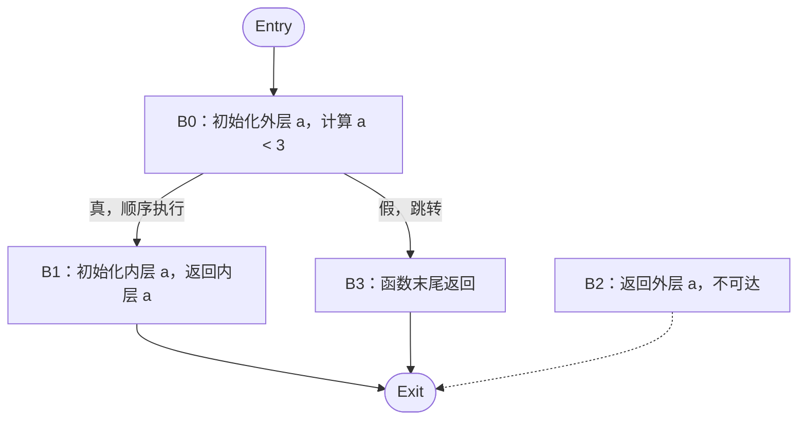

# stage-2

姓名：王锦博  
学号：2024012103  

## 一、实验内容

本次实验在 stage-1 的基础上，实现了局部变量的声明、初始化和赋值，以及嵌套代码块中的作用域和变量遮蔽。代码提交在 `stage-2` 分支，提交号为 `df7e0063`。

本次实验主要实现以下部分：

| 文件 | 实现内容 |
| --- | --- |
| `frontend/scope/scopestack.py` | 实现作用域栈，以及当前层和逐层查找 |
| `frontend/typecheck/namer.py` | 解析变量名，检查重复声明和未声明变量 |
| `frontend/tacgen/tacgen.py` | 生成变量声明、读取和赋值的 TAC |
| `backend/riscv/riscvasmemitter.py` | 将 TAC 赋值指令转换为 `mv` |
| `backend/dataflow/cfg.py` | 求出从入口可达的基本块 |
| `backend/reg/bruteregalloc.py` | 跳过不可达基本块 |

### 1. 作用域和变量名解析

用列表维护作用域栈，进入一个代码块时压入新的 `Scope`，退出时弹出。函数体本身也是一个代码块，按同样方式处理。

声明变量时，只检查栈顶作用域：如果存在同名变量就报错，否则创建一个新的 `VarSymbol`。使用变量时，从栈顶向外查找，找到最近的声明；如果始终找不到，就报告未声明变量。

遍历按照源代码顺序进行，并将查到的符号保存到 AST 节点上。

### 2. 中间代码和目标代码

每次声明变量，都为其符号分配一个独立的 `Temp`。有初始化表达式时，先计算表达式，再生成 `Assign`；读取变量时，直接使用符号保存的 `Temp`。不同作用域中的同名变量对应不同的 `Temp`，因此不会互相覆盖。

赋值表达式先生成右侧的代码，再把结果写入左侧变量，同时保存赋值表达式的值。这样就可以处理 `a = b = 4`：先完成 `b = 4`，再把结果赋给 `a`。

后端将 `Assign(dst, src)` 转换为 `Riscv.Move(dst, src)`，最终输出 `mv` 指令。寄存器分配和溢出到栈上的处理沿用已有实现。

### 3. 不可达基本块

在 CFG 中从入口块 `0` 出发，使用栈进行深度优先遍历，将访问到的基本块放入 `reachable` 集合。寄存器分配时只处理可达块。

这样可以避免为 `return` 后不会执行的代码分配寄存器，也能避免尝试加载没有栈位置的临时变量。变量名检查仍在之前完成，所以不可达代码中的重复声明和未声明变量仍会报错。

## 二、思考题

### 1. 将栈帧扩大 16 字节

```asm
addi sp, sp, -16
```

栈向低地址增长，因此将 `sp` 减去 16，就为当前栈帧增加了 16 字节空间。

### 2. 如果允许同一作用域重复声明同名变量

需要修改声明处理的两点：取消当前作用域的重名检查，并在解析初始化表达式之后，再将新符号加入符号表。

以题目中连续三次声明 `a` 为例，应分别创建符号 `a₀`、`a₁`、`a₂`。解析 `f(a)` 时，符号表仍指向 `a₀`；解析完后，再把名字 `a` 的映射改为 `a₁`。同理，`g(a)` 中的 `a` 绑定到 `a₁`，之后映射再更新为 `a₂`。

变量查找仍然从内向外进行，不需要改变。每个声明创建独立符号和 `Temp`，已经解析的 AST 节点保留原来的符号引用，后续声明不会影响之前的使用。这样就能区分同一作用域中不同位置的同名定义。

### 3. TAC 基本块划分和控制流图

对 step6 题目给出的程序，外层变量 `a` 对应 `_T0`，内层变量 `a` 对应 `_T4`。不做常量折叠时，TAC 可以划分为下面四个基本块：

```text
B0:
    _T1 = 2
    _T0 = _T1
    _T2 = 3
    _T3 = (_T0 < _T2)
    if (_T3 == 0) branch B3

B1:
    _T5 = 3
    _T4 = _T5
    return _T4

B2:
    return _T0

B3:
    return
```

其中 `B3` 是函数末尾补充的返回，对应当前框架生成的返回值 `0`。控制流图如下，`Entry` 和 `Exit` 仅表示函数入口与出口：



条件跳转和每条 `return` 都结束一个基本块。`B1` 已经返回，因此不存在 `B1 → B2` 的边，`B2` 从入口不可达。虽然这里的条件实际恒为真，但未做常量折叠的 CFG 仍保留真假两条分支。

## 三、测试结果

| 测试 | 结果 |
| --- | --- |
| step1–4 公开回归测试 | 21/21 |
| step5–6 公开测试 | 12/12 |
| 官方 CI 代码测试 | 44/44|

## 四、参考资料与 AI 使用

本次参考了课程提供的代码框架，以及 [step5 实验指导](https://decaf-lang.github.io/minidecaf-tutorial/docs/step5/example.html)和 [step6 实验指导](https://decaf-lang.github.io/minidecaf-tutorial/docs/step6/example.html)

使用 Codex 辅助理解实验框架，以及检查修改代码实现。
