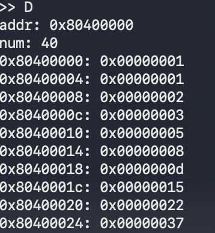
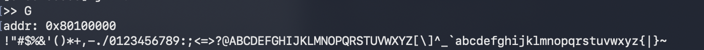
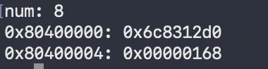

# 实验 1：汇编语言与监控程序（实验报告）

姓名：王锦博

学号：2024012103

## 一、实验目的

熟悉 RV32I 汇编程序的编写、监控程序与 Term 的交互，以及在 QEMU 中装入和运行用户程序的方法

## 二、实验内容与结果

编译并启动基础版 Kernel，使用 Term 连接 QEMU。三段程序均用 `F` 命令装入 `0x80100000`，再用 `G` 命令运行；需要检查内存时使用 `D` 命令。

### 1. 前 10 个 Fibonacci 数

**思路：**用两个寄存器保存相邻两项，每轮将当前项写入内存，再计算下一项。连续写入 10 个 32 位字。

**代码：**

```asm
li t0, 0x80400000
li t1, 1
li t2, 1
li t3, 10
loop:
sw t1, 0(t0)
add t4, t1, t2
addi t0, t0, 4
mv t1, t2
mv t2, t4
addi t3, t3, -1
bne t3, zero, loop
jr ra
```

**结果：**



### 2. 输出 ASCII 可见字符

**思路：**从 `0x21` 循环到 `0x7E`，逐个调用文档给出的 `WRITE_SERIAL` 输出字符。调用前保存返回监控程序所需的 `ra`。

**代码：**

```asm
li s0, 0x21
li s1, 0x7f
mv s2, ra
loop:
mv a0, s0
jal ra, WRITE_SERIAL
addi s0, s0, 1
bne s0, s1, loop
mv ra, s2
jr ra
WRITE_SERIAL:
li t0, 0x10000000
.TESTW:
lb t1, 5(t0)
andi t1, t1, 0x20
beq t1, zero, .TESTW
sb a0, 0(t0)
jr ra
```

**结果：**



### 3. 第 60 个 Fibonacci 数

**思路：**用高、低两个 32 位寄存器表示一个 64 位数。先计算低字，再用 `sltu` 判断进位，并把进位加到高字；循环 58 次得到第 60 项。`sltu` 不在基础版 Kernel 的 19 条指令内，后续若在自制处理器上运行此程序，还需实现它。

**代码：**

```asm
li t0, 0x80400000
li t1, 1
li t2, 0
li t3, 1
li t4, 0
li t5, 58
loop:
add t6, t1, t3
sltu a0, t6, t1
add a1, t2, t4
add a1, a1, a0
mv t1, t3
mv t2, t4
mv t3, t6
mv t4, a1
addi t5, t5, -1
bne t5, zero, loop
sw t3, 0(t0)
sw t4, 4(t0)
jr ra
```

**结果：**



## 三、思考题

1. **RISC-V 与 x86 寻址方式：**两者都支持寄存器、立即数等操作数。RISC-V 访存主要使用“基址寄存器＋有符号偏移”，分支可使用 PC 相对地址；x86 的内存操作数还能组合基址、变址、比例因子和位移，寻址方式更复杂。
2. **基础版 Kernel 的 19 条指令：**算术逻辑类有 ADD、ADDI、AND、ANDI、OR、ORI、XOR、SLLI、SRLI；访存类有 LB、LW、SB、SW；分支与跳转类有 BEQ、BNE、JAL、JALR；高位立即数与 PC 相关类有 LUI、AUIPC。分类依据是指令对数据、内存和程序计数器的作用。
3. **Term 如何计时：**`kernel/kern/shell.S` 在运行用户程序前后分别发送 `0x06` 和 `0x07`；`term/term.py` 的 `run_G()` 在收到这两个标志时读取本机计时器并计算差值。因此显示的是终端侧经过时间，而非处理器周期数。
4. **Kernel 如何使用串口：**`kernel/kern/utils.S` 的 `READ_SERIAL` 和 `WRITE_SERIAL` 轮询 `0x10000005` 的状态位，再从 `0x10000000` 读入或写出一个字节。
5. **Term 如何检查 Kernel 已连接：**`kernel/kern/init.S` 的 `WELCOME` 输出欢迎信息；`term/term.py` 的 `Main()` 读取欢迎信息后发送 `W`；`kernel/kern/shell.S` 对该探测返回 XLEN。Term 收到 `4` 或 `8` 后确定字长，但不会逐字校验欢迎字符串。
