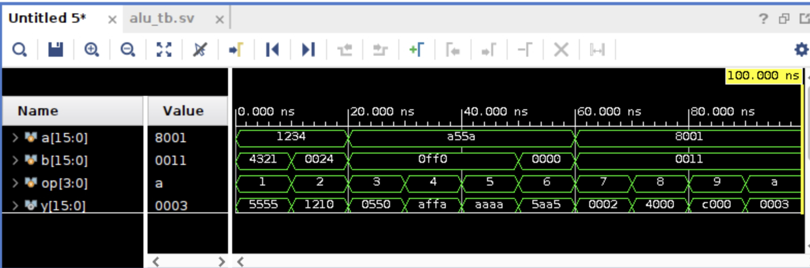
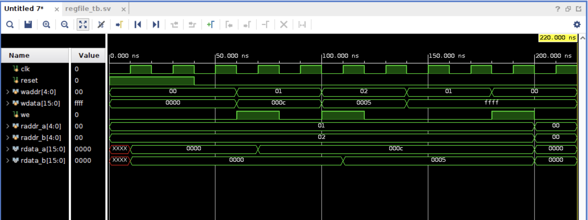
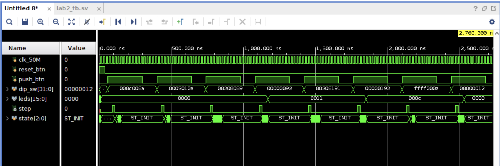
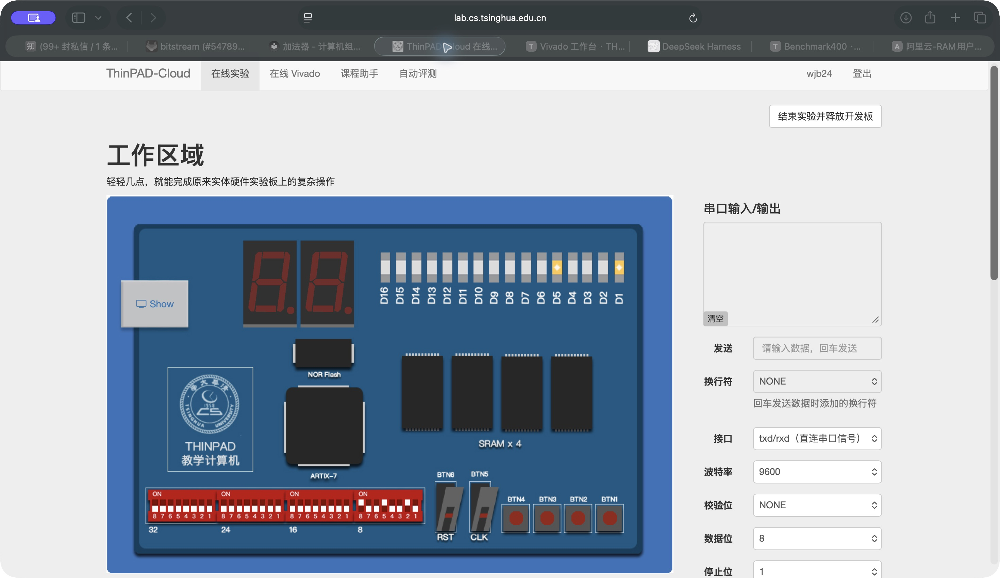
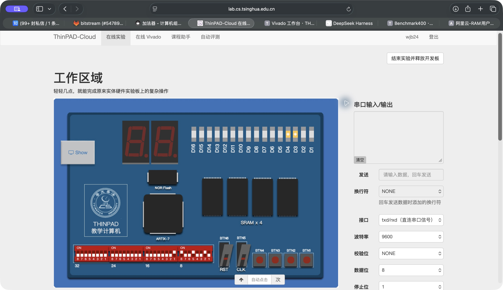
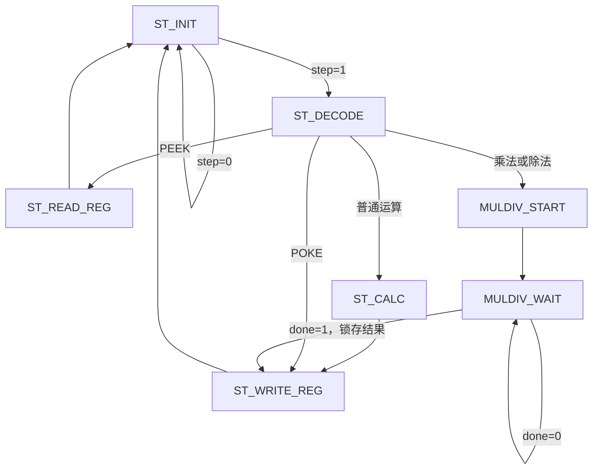

# 实验 2：ALU 与寄存器堆

姓名：王锦博　学号：2024012103

## 一、实验思路

将电路分为 ALU、寄存器堆和控制器三个模块。ALU 用组合逻辑完成 16 位运算；寄存器堆提供两个读端口和一个同步写端口，`x0` 恒为 0。按钮经过同步和上升沿检测产生单周期 `step`，控制器据此锁存拨码开关上的指令，并通过状态机完成译码、运算和写回。POKE 将立即数写入寄存器，计算指令读取操作数并写回 ALU 结果，PEEK 将寄存器值显示在 LED 上。先分别仿真各模块，再验证完整指令流程，最后上板检查结果。

## 二、仿真验证

### 1. ALU

每隔 10 ns 切换一次操作码，依次测试加、减、与、或、异或、非、逻辑左移、逻辑右移、算术右移和循环左移。

加减法分别得到 `0x5555` 和 `0x1210`；按位运算使用 `0xa55a`、`0x0ff0`，便于观察各位的变化。移位测试使用 `A=0x8001`、`B=17`，验证移位量对 16 取余，以及补零、补符号位和循环移位的区别。四种移位结果依次为 `0x0002`、`0x4000`、`0xc000`、`0x0003`，与预期一致。

### 2. 寄存器堆

时钟周期为 20 ns。先复位，再依次向 `x1`、`x2` 写入 12 和 5，两个读端口分别读出 `0x000c`、`0x0005`，验证上升沿写入和双端口读取。随后在 `we=0` 时改变写地址和数据，`x1` 保持不变；最后尝试向 `x0` 写入 `0xffff`，两个读端口读取 `x0` 均得到 0。

### 3. 完整指令流程

依次输入下表中的指令。每次将 `push_btn` 保持高电平 12 个时钟周期，再拉低，验证一次长按只执行一条指令。

| 指令编码（十六进制） | 操作 | 预期结果 |
| --- | --- | --- |
| `000c008a` | POKE x1, 12 | x1 = 12 |
| `0005010a` | POKE x2, 5 | x2 = 5 |
| `00208089` | ADD x1, x1, x2 | x1 = 17 |
| `00000092` | PEEK x1 | LED = 0x0011 |
| `00208191` | SUB x3, x1, x2 | x3 = 12 |
| `00000192` | PEEK x3 | LED = 0x000c |
| `ffff000a` | POKE x0, 0xffff | x0 = 0 |
| `00000012` | PEEK x0 | LED = 0x0000 |

波形中，每次按下按钮只产生一个 `step` 脉冲。状态机完成指令后回到 `ST_INIT`；三次 PEEK 后，LED 依次显示 `0x0011`、`0x000c`、`0x0000`，与预期一致。

## 三、云平台上板验证

将生成的比特流加载到云平台，复位后通过拨码开关输入上述指令，每输入一条指令按一次执行按钮。

### 1. 加法与读出

先用 POKE 写入 `x1=12`、`x2=5`，执行 `ADD x1,x1,x2`，再用 PEEK 读取 `x1`。图中 D5、D1 亮，对应 `0x0011=17`，加法及读出结果正确。

### 2. 减法与读出

继续执行 `SUB x3,x1,x2`，再用 PEEK 读取 `x3`。图中 D4、D3 亮，对应 `0x000c=12`，与 `17-5=12` 一致。

## 四、思考题：支持多周期乘除法

在原状态机中增加 `MULDIV_START` 和 `MULDIV_WAIT`。普通运算、POKE 和 PEEK 保持原有流程；乘除法启动后等待完成，再写回结果。

`MULDIV_START` 保存操作数、运算类型和目标寄存器，并产生一个周期的 `start` 脉冲。`MULDIV_WAIT` 中保持这些信息，关闭寄存器堆写使能；收到 `done` 后锁存结果，进入 `ST_WRITE_REG` 写回，再返回 `ST_INIT` 接收下一条指令。写回数据根据指令选择立即数、普通 ALU 结果或乘除法结果；复位时控制器回到 `ST_INIT`，同时复位乘除法单元。

实验依据：[计算机组成原理（2026 年）实验 2 文档](https://lab.cs.tsinghua.edu.cn/cod-lab-docs/labs/lab2/lab2/)。
